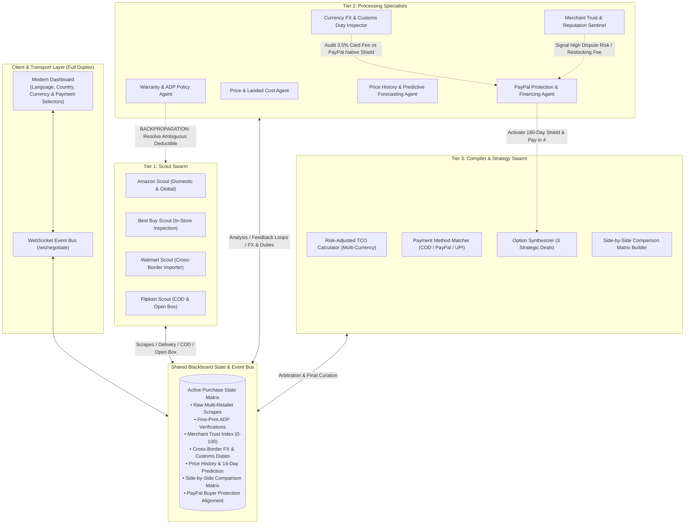

# ProductFind 🛡️
### Bidirectional Multi-Agent Commerce Agent with PayPal Buyer Protection & Pay Later Integration
*Built for the [PayPal AI Hackathon on Devpost](https://paypalaihackathon.devpost.com/)*

---

## 🌟 Overview

Shopping online based solely on "sticker price" is a consumer trap. The cheapest price often hides severe risks:
- **Grey-market imports** lacking manufacturer warranty coverage
- **Deceptive 20% restocking fees** on opened returns
- **Hidden high-deductible Accidental Damage Protection (ADP)** clauses
- **Unreliable third-party sellers** with poor dispute records
- **Hidden cross-border import duties and 3.5% foreign transaction bank surcharges**
- **Missing Cash on Delivery or fraudulent empty box shipments lacking Open Box inspection**

**ProductFind** solves this with a **Bidirectional Multi-Agent Swarm (Blackboard Architecture)** that scours listings, interrogates fine-print terms, audits merchant trust, evaluates delivery speeds and COD/Open Box availability, forecasts price trajectories, calculates a **Risk-Adjusted Total Cost of Ownership (TCO)**, and compares foreign credit card fees against **PayPal Native Currency Conversion** and **180-Day PayPal Buyer Protection**.

---

## 🏗️ Architecture: Bidirectional Multi-Agent Swarm

Unlike traditional linear pipelines (`Scrape -> Prompt -> Output`), ProductFind uses a cyclic state graph with active backward feedback loops, specialized cross-border engines, and multi-language support:



---

## 🚀 Key Features

### 1. Multilingual Natural Language Support (i18n)
- **Select Preferred Language:** English 🇺🇸, Hindi (हिंदी) 🇮🇳, Spanish (Español) 🇪🇸, German (Deutsch) 🇩🇪, French (Français) 🇫🇷, and Japanese (日本語) 🇯🇵.
- Agent thoughts, status logs, deal cards, and checkout alerts translate dynamically into the user's preferred language.

### 2. Destination Country & Merchant Origin Auditing
- Select destination country (United States 🇺🇸, India 🇮🇳, United Kingdom 🇬🇧, Germany 🇩🇪, Canada 🇨🇦, Japan 🇯🇵, Australia 🇦🇺).
- Dynamically audits domestic vs. international listings.
- Recalculates estimated delivery windows based on route distance (e.g., 1-2 day domestic express vs 7-12 day cross-border air freight).

### 3. Multi-Currency Engine & Live FX Rates
- Converts prices and risk-adjusted TCO seamlessly across USD (`$`), INR (`₹`), EUR (`€`), GBP (`£`), CAD (`CA$`), JPY (`¥`), and AUD (`A$`).
- Displays both original merchant currency and converted preferred currency.

### 4. Estimated Delivery Time & Shipping Speed Tiers
- Audits merchant shipping methods: Next-Day Curbside, 2-Day Express, Standard Ground, and Cross-Border Air Freight.
- Displays realistic delivery estimates prominently on each deal card and comparison row.

### 5. Cash on Delivery (COD) Availability & Fee Auditor
- Detects if Cash on Delivery (COD) is available (e.g., Flipkart / domestic couriers) or if the transaction requires advance digital payment.
- Audits COD handling fees and doorstep terms.

### 6. Open Box Delivery Verification
- Inspects whether the merchant provides **Open Box Delivery** (where the courier opens the seal and inspects the physical device/IMEI in front of the buyer before accepting the OTP).
- Protects buyers against empty box/brick scams; factors into the mathematical Risk-Adjusted TCO formula.

### 7. Return & Exchange / Trade-In Offers
- Audits return window length (7-day replacement vs 14-day vs 30-day refund) and restocking penalty fees.
- Evaluates manufacturer trade-in and exchange offers (e.g., up to $120 / ₹10,000 credit on trading in an old device).

### 8. Preferred Payment Alignment & Highlighting
- Filter or sort recommendations based on user's preferred payment method:
  - **All Payments**
  - **PayPal & Pay in 4** (Highlights 180-day Buyer Protection & 0% APR biweekly financing)
  - **Cash on Delivery (COD)** (Highlights doorstep cash/UPI acceptance)
  - **Credit / Debit Card** (Warns on international 3.5% foreign transaction bank surcharges)
  - **UPI / Net Banking** (Regional instant payments)

### 9. AG Grid E-Commerce Swarm Matrix (🏆 Sponsor: Best Use of AG Grid)
- An enterprise-grade, high-performance data grid powered by **AG Grid (Quartz Dark Theme)**:
  - **Custom Cell Renderers:** Renders store branding, origin country, condition pills, landed prices, Risk-Adjusted TCO, COD & Open Box badges, and embedded 1-click PayPal checkout triggers directly inside cells.
  - **Pinned Columns:** Store & Merchant pinned to the left; PayPal Action button pinned to the right for seamless horizontal exploration.
  - **Multi-Column Sorting & Filtering:** Sort by TCO, Landed Price, or Trust Score with instant interactive response.
  - **Live Quick Search:** Filter across every policy term simultaneously.
  - **One-Click Native CSV Export:** Download full comparison audits locally using AG Grid's native `gridApi.exportDataAsCsv()`.
  - **KPI Summary Ribbon:** Real-time statistics on total listings audited, lowest TCO, and COD/Open Box availability counts.

### 10. 90-Day Price History Trajectory
- Tracks historical price movements across 90-day intervals.
- Computes **All-Time Low (ATL)**, **All-Time High (ATH)**, and **90-Day Moving Average** with an interactive SVG chart.

### 11. AI Price Prediction Engine
- Statistical & market cycle forecasting for 14-day price movements.
- Delivers an actionable **Buy Verdict**:
  - 🟢 **BUY NOW (Near All-Time Low)**
  - 🟡 **WAIT (Flash Sale / Cyclical Drop Expected)**
  - 🔵 **FAIR VALUE**
- Provides prediction confidence score (e.g. 88%) and detailed market explanation.

### 12. Cross-Border FX, Import Duties & Bank Card Fee vs PayPal Native Conversion
- For international merchants, checks live FX rates and calculates:
  - Estimated **Import Customs Duties** (e.g., 18.5% for electronics US → IN).
  - Standard **Credit Card Foreign Transaction Fee** (3.5% bank surcharge with zero cross-border dispute protection).
  - Versus **PayPal Native Currency Conversion**: Transparent exchange rate locked upfront with **180-Day Cross-Border PayPal Buyer Protection** covering lost overseas freight, customs seizures, and international seller dispute mediation.

### 13. Native PayPal Integration (Hackathon Core)
- **PayPal Buyer Protection Recommendation Engine:** Directly assesses seller risks (restocking fee, third-party seller, short return window, cross-border freight) and activates tailored protection shield alerts.
- **PayPal Pay in 4 (BNPL):** Dynamically calculates bi-weekly split payments in the user's preferred currency.
- **PayPal Orders v2 API:** Seamlessly creates (`/v2/checkout/orders`) and captures sandbox payments directly in the selected currency.

---

## 🛠️ Quickstart & Local Installation

### Prerequisites
- Python 3.10+
- Modern Web Browser

### 1. Clone & Setup
```bash
git clone https://github.com/yuvanshankarm007/ProductFind.git
cd ProductFind
```

### 2. Install Dependencies
```bash
pip install fastapi uvicorn websockets pydantic httpx pytest
```

### 3. (Optional) Configure PayPal Sandbox Keys
Create a `.env` file or export your credentials:
```bash
export PAYPAL_CLIENT_ID="your-paypal-sandbox-client-id"
export PAYPAL_CLIENT_SECRET="your-paypal-sandbox-client-secret"
```
*(If omitted, ProductFind defaults to automated sandbox simulation mode for instant evaluation without requiring keys)*.

### 4. Run the Full-Stack Application
```bash
python -m uvicorn backend.server:app --port 8000 --reload
```
Open your browser to: **http://localhost:8000**

---

## 🧪 Running Automated Swarm Tests

Run the built-in end-to-end verification suite:
```bash
python test_sentinel.py
```

Run the server endpoint tests:
```bash
python test_server_routes.py
```

Expected output:
```
=== STARTING PRODUCTFIND SENTINEL VERIFICATION TEST ===
 [x] EventBus Pub/Sub operational.
 [x] Tier 1 Scouts collected 4 merchant listings.
 [x] Bidirectional Feedback Loops triggered: 1 back-propagation queries resolved.
 [x] Tier 2 Merchant Audit (Trust, Delivery, COD & Open Box) verified.
 [x] Cross-Border FX & Import Duty Inspector: FX rate, duties, and card 3.5% fee vs PayPal shield.
 [x] Price History & AI Prediction Agent: ATL, ATH, 90d Avg, and 14d Forecast verdict verified.
 [x] Tier 3 Strategy Options Curated: Optimal Value, Max Protection, Budget Sticker.
 [x] Comparison Matrix Generated with 4 rows.
 [x] Localized Hindi events generated: 12 events matched.
 [x] PayPal Orders API v2 createOrder successful for INR.
 [x] PayPal Orders API v2 captureOrder successful for INR.
=== ALL SYSTEMS OPERATIONAL AND VERIFIED ===
```

---

## 📄 License
PolyForm Noncommercial License 1.0.0. Free for noncommercial and educational use; commercial use requires permission from Yuvan Shankar.
