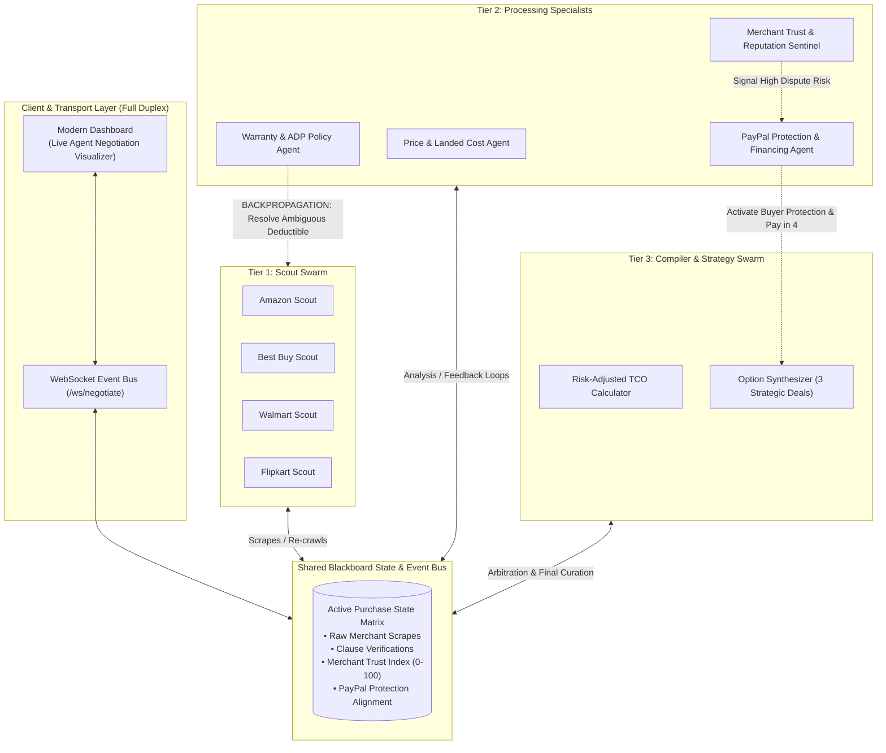

# PayPal Sentinel AI 🛡️
### Bidirectional Multi-Agent Commerce Agent with PayPal Buyer Protection & Pay Later Integration
*Built for the [PayPal AI Hackathon on Devpost](https://paypalaihackathon.devpost.com/)*

---

## 🌟 Overview

Shopping online based solely on "sticker price" is a consumer trap. The cheapest price often hides severe risks:
- **Grey-market imports** lacking manufacturer warranty coverage
- **Deceptive 20% restocking fees** on opened returns
- **Hidden high-deductible Accidental Damage Protection (ADP)** clauses
- **Unreliable third-party sellers** with poor dispute records

**PayPal Sentinel AI** solves this with a **Bidirectional Multi-Agent Swarm (Blackboard Architecture)** that scours listings, interrogates fine-print terms, audits merchant trust, and calculates a **Risk-Adjusted Total Cost of Ownership (TCO)**—while natively recommending and executing **PayPal Buyer Protection** and **PayPal Pay in 4** checkout.

---

## 🏗️ Architecture: Bidirectional Multi-Agent Swarm

Unlike traditional linear pipelines (`Scrape -> Prompt -> Output`), PayPal Sentinel uses a cyclic state graph with active backward feedback loops:



---

## 🚀 Key Features

### 1. Fine-Print Warranty & ADP Extractor
- Analyzes OEM warranty duration (3 mo vs 12 mo vs 24 mo).
- Detects drops, liquid spills, and power surge coverage.
- Verifies deductible amounts per claim (e.g., $0 vs $25 vs $99).
- **Bidirectional Trigger:** If terms are vague, the Warranty Agent halts and instructs the Scout to deep-scrape the terms modal before proceeding.

### 2. Merchant Trust & Reputation Sentinel (0–100 Score)
- Audits merchant reliability, return windows, and restocking penalties.
- Flags grey-market parallel importers vs. authorized brand distributors.
- Extracts recurring dispute patterns (*"refused refund"*, *"slow RMA"*, *"counterfeit risk"*).

### 3. Native PayPal Integration (Hackathon Core)
- **PayPal Buyer Protection Recommendation Engine:** Automatically assesses merchant risks. When a seller has a strict return window or restocking fee, Sentinel displays a dedicated protection alert explaining how PayPal Buyer Protection covers the buyer up to 180 days.
- **PayPal Pay in 4 (BNPL):** Dynamically calculates bi-weekly split payments including optional ADP protection bundles.
- **PayPal Orders v2 API:** Seamlessly creates (`/v2/checkout/orders`) and captures sandbox payments directly within the app.

### 4. Live Full-Duplex Agent Thought Visualizer
- The web dashboard connects via WebSockets (`/ws/negotiate`) to display live agent-to-agent negotiations, back-propagation requests, and resolutions in real time.

---

## 🛠️ Quickstart & Local Installation

### Prerequisites
- Python 3.10+
- Modern Web Browser

### 1. Clone & Setup
```bash
git clone https://github.com/your-username/paypal-sentinel.git
cd paypal-sentinel
```

### 2. Install Dependencies
```bash
pip install fastapi uvicorn websockets pydantic httpx
```

### 3. (Optional) Configure PayPal Sandbox Keys
Create a `.env` file or export your credentials:
```bash
export PAYPAL_CLIENT_ID="your-paypal-sandbox-client-id"
export PAYPAL_CLIENT_SECRET="your-paypal-sandbox-client-secret"
```
*(If omitted, Sentinel defaults to automated sandbox simulation mode for instant evaluation without requiring keys).*

### 4. Run the Full-Stack Application
```bash
python -m uvicorn backend.server:app --port 8000 --reload
```

Open your browser to: **`http://localhost:8000`**

---

## 🧪 Running Automated Swarm Tests

Run the built-in end-to-end verification suite:
```bash
python test_sentinel.py
```

Expected output:
```
=== STARTING PAYPAL SENTINEL VERIFICATION TEST ===
 [x] EventBus Pub/Sub operational.
 [x] Tier 1 Scouts collected 4 merchant listings.
 [x] Bidirectional Feedback Loops triggered: 1 back-propagation queries resolved.
 [x] Tier 2 Merchant Trust Scores calculated.
 [x] Tier 3 Strategy Options Curated: Optimal Value, Max Protection, Budget Sticker.
 [x] PayPal Orders API v2 createOrder successful.
 [x] PayPal Orders API v2 captureOrder successful.
=== ALL SYSTEMS OPERATIONAL AND VERIFIED ===
```

---

## 📄 License
MIT License. Open-source for the PayPal AI Hackathon 2026.
