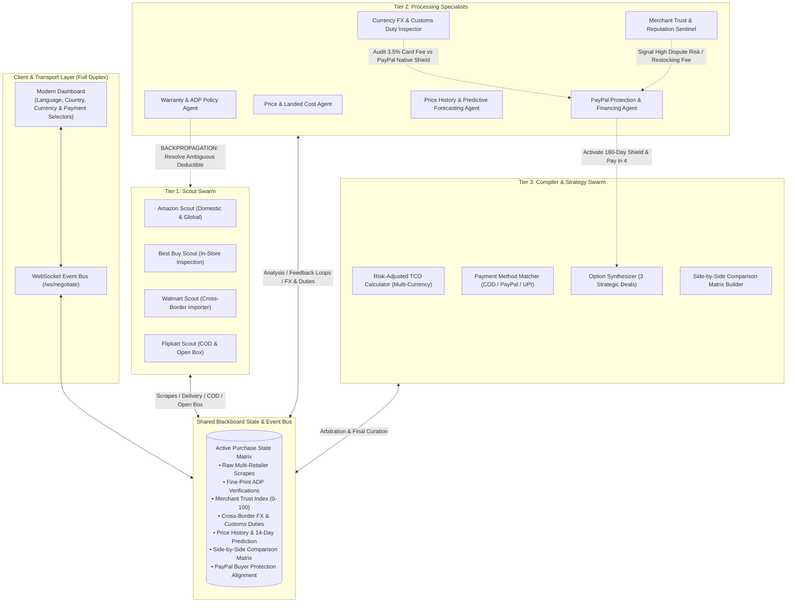

# ProductFind Sentinel 🛡️
### Autonomous Multi-Agent Commerce Engine with PayPal Dispute Protection, AG Grid Cockpit & MCP Server

[](./LICENSE)

---

## 🏆 Hackathon Technology Integration (PayPal + AI + Sponsors)

* **PayPal Developer Platform (Sandbox REST APIs):**
  * **OAuth 2.0 (`/v1/oauth2/token`) & Orders v2 API (`/v2/checkout/orders`):** Multi-currency `createOrder` and `captureOrder` execution (`backend/paypal_service.py`) embedded directly in AG Grid rows and checkout flows, with resilient Sandbox Demo Fallback when credentials are omitted.
  * **PayPal Pay in 4 / Pay Later & Cross-Border FX Shield:** Bi-weekly financing calculation + Smart Wallet Stacker comparison eliminating 3.5% foreign card surcharges.
  * **PayPal Section 13 Buyer Protection & Forensic Dispute Guard:** Seals checkout terms (`checkout_snapshot`) and SHA-256 Merkle proofs into pure-Python **Section 13 Chargeback PDF Dossiers** (`backend/core/pdf_generator.py`, `backend/core/dispute_assistant.py`).
* **AI Tools, Models & Services:**
  * **Autonomous Multi-Agent Blackboard Swarm (`SentinelCoordinator`)** & Voyager/Reflexion-inspired `AdaptiveSkillLearner` for test-time policy auditing and invariant verification.
  * **Gemini / OpenAI Vision-LLM + Cross-Platform OCR (`visual_search.py`)** for product packaging recognition.
  * **Gemini / OpenAI Community Consensus & Interactive Concierge** (`reddit_consensus.py`, `concierge_bot.py`) backed by live **iFixit Suggest 2.0**, **Hacker News Algolia**, and **DuckDuckGo Reddit** lookups.
  * **Econometric Multi-Timeframe Predictor & 0/1 Knapsack Cart-Splitter** + **Native MCP JSON-RPC 2.0 Server (`/mcp`)** exposing 4 tools for external AI agents.
* **Sponsor Integrations:**
  * **AG Grid Community (`v31.0.3`, Quartz Dark Theme):** Pinned left merchant metadata, pinned right 1-click PayPal checkout triggers, custom trust/COD/Open-Box/FX renderers, live quick-filter search, and native CSV export (`gridApi.exportDataAsCsv()`).
  * **Google Cloud Platform:** Optional Firestore Native Mode & Memorystore Redis persistence + Terraform IaC (`deploy/terraform`), with local SQLite/JSON zero-crash fallback.

---

## 🌟 Overview

Shopping online based solely on "sticker price" is a consumer trap. The cheapest price often hides severe risks:
- **Grey-market imports** lacking manufacturer warranty coverage
- **Deceptive 20% restocking fees** on opened returns
- **Hidden high-deductible Accidental Damage Protection (ADP)** clauses
- **Unreliable third-party sellers** with poor dispute records
- **Hidden cross-border import duties and 3.5% foreign transaction bank surcharges**
- **Missing Cash on Delivery or fraudulent empty box shipments lacking Open Box inspection**

**ProductFind** solves this with a **Bidirectional Multi-Agent Swarm (Blackboard Architecture)** that scours listings, interrogates fine-print terms, audits merchant trust, evaluates delivery speeds and COD/Open Box availability, forecasts price trajectories, calculates a **Risk-Adjusted Total Cost of Ownership (TCO)**, and compares foreign credit card fees against **PayPal Native Currency Conversion** and **180-Day PayPal Buyer Protection**.

---

## 🏗️ Architecture: Bidirectional Multi-Agent Swarm

Unlike traditional linear pipelines (`Scrape -> Prompt -> Output`), ProductFind uses a cyclic state graph with active backward feedback loops, specialized cross-border engines, and multi-language support:



---

## 🚀 Key Features

### 1. Multilingual Natural Language Support (i18n)
- **Select Preferred Language:** English 🇺🇸, Hindi (हिंदी) 🇮🇳, Spanish (Español) 🇪🇸, German (Deutsch) 🇩🇪, French (Français) 🇫🇷, and Japanese (日本語) 🇯🇵.
- Agent thoughts, status logs, deal cards, and checkout alerts translate dynamically into the user's preferred language.

### 2. Destination Country & Merchant Origin Auditing
- Select destination country (United States 🇺🇸, India 🇮🇳, United Kingdom 🇬🇧, Germany 🇩🇪, Canada 🇨🇦, Japan 🇯🇵, Australia 🇦🇺).
- Dynamically audits domestic vs. international listings.
- Recalculates estimated delivery windows based on route distance (e.g., 1-2 day domestic express vs 7-12 day cross-border air freight).

### 3. Multi-Currency Engine & Live FX Rates
- Converts prices and risk-adjusted TCO seamlessly across USD (`$`), INR (`₹`), EUR (`€`), GBP (`£`), CAD (`CA$`), JPY (`¥`), and AUD (`A$`).
- Displays both original merchant currency and converted preferred currency.

### 4. Estimated Delivery Time & Shipping Speed Tiers
- Audits merchant shipping methods: Next-Day Curbside, 2-Day Express, Standard Ground, and Cross-Border Air Freight.
- Displays realistic delivery estimates prominently on each deal card and comparison row.

### 5. Cash on Delivery (COD) Availability & Fee Auditor
- Detects if Cash on Delivery (COD) is available (e.g., Flipkart / domestic couriers) or if the transaction requires advance digital payment.
- Audits COD handling fees and doorstep terms.

### 6. Open Box Delivery Verification
- Inspects whether the merchant provides **Open Box Delivery** (where the courier opens the seal and inspects the physical device/IMEI in front of the buyer before accepting the OTP).
- Protects buyers against empty box/brick scams; factors into the mathematical Risk-Adjusted TCO formula.

### 7. Return & Exchange / Trade-In Offers
- Audits return window length (7-day replacement vs 14-day vs 30-day refund) and restocking penalty fees.
- Evaluates manufacturer trade-in and exchange offers (e.g., up to $120 / ₹10,000 credit on trading in an old device).

### 8. Preferred Payment Alignment & Highlighting
- Filter or sort recommendations based on user's preferred payment method:
  - **All Payments**
  - **PayPal & Pay in 4** (Highlights 180-day Buyer Protection & 0% APR biweekly financing)
  - **Cash on Delivery (COD)** (Highlights doorstep cash/UPI acceptance)
  - **Credit / Debit Card** (Warns on international 3.5% foreign transaction bank surcharges)
  - **UPI / Net Banking** (Regional instant payments)

### 9. AG Grid E-Commerce Swarm Matrix (🏆 Sponsor: Best Use of AG Grid)
- An enterprise-grade, high-performance data grid powered by **AG Grid (Quartz Dark Theme)**:
  - **Custom Cell Renderers:** Renders store branding, origin country, condition pills, landed prices, Risk-Adjusted TCO, COD & Open Box badges, and embedded 1-click PayPal checkout triggers directly inside cells.
  - **Pinned Columns:** Store & Merchant pinned to the left; PayPal Action button pinned to the right for seamless horizontal exploration.
  - **Multi-Column Sorting & Filtering:** Sort by TCO, Landed Price, or Trust Score with instant interactive response.
  - **Live Quick Search:** Filter across every policy term simultaneously.
  - **One-Click Native CSV Export:** Download full comparison audits locally using AG Grid's native `gridApi.exportDataAsCsv()`.
  - **KPI Summary Ribbon:** Real-time statistics on total listings audited, lowest TCO, and COD/Open Box availability counts.

### 10. Stock-Style Multi-Timeframe Price Trajectory & Timing Terminal
- Tracks historical price movements across **`1D · Hourly` (25 ticks)**, **`7D`**, **`1M` (30D)**, **`90D`**, and **`1Y`** intervals alongside a toggleable **`+14D Forecast`** zone.
- Features interactive crosshair scrubbing, live quote delta header updates, volume-impulse bars, period `LOW`/`HIGH` pins, Fair-Value baseline, and **All-Time Low (ATL)** / **All-Time High (ATH)** telemetry.

### 11. AI Price Prediction & Watchdog Webhook Engine
- Statistical & market cycle forecasting for 14-day price movements with actionable Buy Verdicts (**BUY NOW**, **WAIT FOR DIP**, **FAIR VALUE**) and confidence scores.
- **Price Watchdog (`🎯 Price Alerts`):** Supports currency-aware target price subscriptions with real-time **Discord & Slack webhook** dispatch (`backend/core/price_watchdog.py`).

### 12. Cross-Border FX, Import Duties & Bank Card Fee vs PayPal Native Conversion
- For international merchants, checks live FX rates and calculates:
  - Estimated **Import Customs Duties** (e.g., 18.5% for electronics US → IN).
  - Standard **Credit Card Foreign Transaction Fee** (3.5% bank surcharge with zero cross-border dispute protection).
  - Versus **PayPal Native Currency Conversion**: Transparent exchange rate locked upfront with **180-Day Cross-Border PayPal Buyer Protection** covering lost overseas freight, customs seizures, and international seller dispute mediation.

### 13. Native PayPal Integration & Dispute Escrow
- **PayPal Buyer Protection Recommendation Engine:** Directly assesses seller risks (restocking fee, third-party seller, short return window, cross-border freight) and activates tailored protection shield alerts.
- **PayPal Pay in 4 (BNPL):** Dynamically calculates bi-weekly split payments in the user's preferred currency.
- **PayPal Orders v2 API:** Seamlessly creates (`/v2/checkout/orders`) and captures sandbox payments directly in the selected currency.

### 14. Reddit Community Hivemind & Peer Consensus
- **Unvarnished Peer Feedback:** Synthesizes multi-month user experiences from `r/BuyItForLife`, `r/gadgets`, `r/apple`, `r/headphones`, `r/pcmasterrace`, and `r/smartphones`.
- **Top Verified Praises & Recurring Complaints:** Highlights authentic real-world pros and cons beyond marketing specs.
- **12+ Month Failure Modes (What Breaks):** Uncovers real degradation patterns (battery capacity drop after heavy MagSafe charging, headband swivel fatigue, coating maintenance).
- **Direct Thread Citations:** Live links to original community discussion threads with upvotes and comment volumes.

### 15. ReviewRay / Fakespot-Grade Review Authenticity Filter
- **Review Integrity Grades (Grade A to D):** Heuristically assesses overall reviewer trustworthiness.
- **Adjusted Honest Star Rating:** Dynamically calculates true customer satisfaction after filtering out incentivized free-sample reviews (e.g. Amazon Vine), burst review campaigns, and unverified bot submissions.
- **Organic vs Synthetic Meter:** Quantifies genuine organic buyer percentage vs bot / sample bias.
- **Fraud Heuristic Telemetry:** Audits verified purchase ratios, review velocity bursts, AI syntax repetition, and star-vs-text sentiment alignment.

### 16. iFixit Repairability & BIFL (Buy It For Life) Longevity Index
- **iFixit Teardown Modularity Score (1–10):** Evaluates physical chassis serviceability and disassembly difficulty.
- **Battery Replacement Feasibility:** Distinguishes user-accessible pull tabs and screw fasteners from permanent glue-in batteries.
- **Expected Lifespan in Years:** Forecasts real-world product lifespan before functional obsolescence.
- **Spare Parts Ecosystem:** Rates availability of OEM and third-party replacement screens, batteries, and switches.

### 17. 7–14 Day Price Drop Probability Forecast
- Statistically projects likelihood of a price reduction within 7–14 days.
- Issues instant actionable guidance: `⚡ BUY NOW` vs `⏳ WAIT FOR DROP`.

---

## 🛠️ Quickstart & Local Installation

### Prerequisites
- Python 3.10+
- Modern Web Browser

### 1. Clone & Setup
```bash
git clone https://github.com/yuvanshankarm007/ProductFind.git
cd ProductFind
```

### 2. Install Dependencies
```bash
pip install -r requirements.txt
```

### 3. (Optional) Configure PayPal Sandbox, AI Keys & Google Cloud
Copy `.env.example` to `.env` or export credentials:
```bash
export PAYPAL_CLIENT_ID="your-paypal-sandbox-client-id"
export PAYPAL_CLIENT_SECRET="your-paypal-sandbox-client-secret"
export GEMINI_API_KEY="optional-gemini-key"
export OPENAI_API_KEY="optional-openai-key"
export GCP_PROJECT_ID="your-gcp-project-id"
export FIRESTORE_DATABASE_ID="(default)"
```
*(All integrations feature zero-crash local fallbacks, requiring no API keys for instant local evaluation.)*

### 4. (Optional) Provision Cloud Infrastructure with Terraform
```bash
cd deploy/terraform
terraform init
terraform plan
terraform apply
```

### 5. Run the Full-Stack Application
```bash
python -m uvicorn backend.server:app --host 127.0.0.1 --port 8000
```
Open your browser to: **http://127.0.0.1:8000**

---

## 🤖 Native MCP JSON-RPC 2.0 Server & Savings Ledger
- **MCP Endpoint (`POST /mcp`, Manifest `GET /api/mcp/manifest`):** Exposes `arbitrate_deal`, `audit_consumer_proof`, `verify_listing_safety`, and `compile_dispute_dossier` for external AI agents.
- **Persistent Savings Ledger (`GET /api/ledger/stats`):** Tracks cumulative arbitrage savings, customs traps flagged, low-trust listings filtered, verified links, and dispute dossiers compiled.
- **SSRF-Safe Pre-Click Link Verifier (`POST /api/verify-link`):** Probes outbound merchant URLs safely before checkout.

---

## 🌟 Interactive Live Experience
When you launch `http://127.0.0.1:8000`, you can explore:
1. **Intelligent Autocomplete & Multi-Agent Swarm**: Click into the search bar to reveal trending deals, budget brackets, and head-to-head showdowns (`iPhone 16 vs Galaxy S24`).
2. **Stock-Style Market Timing Terminal & AG Grid Cockpit**: Switch between `1D · Hourly`, `7D`, `1M`, `90D`, `1Y`, and `+14D Forecast` with crosshair scrubbing, plus live CSV export and pinned PayPal Checkout in AG Grid.
3. **Live Consumer Proof Deck**: Inspect live iFixit 2.0 repairability scores, HN/Reddit discussions, and ReviewRay authenticity grades.
4. **Combinatorial 0/1 Knapsack Bundle Split & Smart Wallet (`💳 My Wallet`)**: Optimize multi-store baskets and stack bank cards + PayPal Pay Later.
5. **Section 13 Cryptographic Dispute Guard (`⚖️ Dispute Guard`)**: Compiles `checkout_snapshot` SHA-256 + Merkle proof pure-Python Section 13 chargeback PDF dossiers.
6. **Multimodal Visual & Voice Studio**: Drag-and-drop packaging photos into Vision-LLM/OCR extraction or dictate via Web Speech voice search.

---

## 🔌 Manifest V3 Chrome Extension
Sentinel includes a full Chrome Extension located in `extension/`:
1. Open Chrome/Brave and navigate to `chrome://extensions/` (`brave://extensions/`).
2. Enable **Developer mode** (top-right toggle).
3. Click **Load unpacked** and select the `extension/` folder in this repository.
4. Navigate to any Amazon (`amazon.in` / `amazon.com`), Flipkart, or Best Buy search or product page — Sentinel automatically activates in-page with live TCO arbitration, ReviewRay grade, and iFixit telemetry!

---

## 🧪 Comprehensive Test Suite

Run the automated test suite (non-Playwright suite):
```bash
python -m pytest tests/ -k "not test_playwright" -q
```
> All **146 collected tests** cover model fidelity, stealth browsing, session isolation, consumer proof, stock-style multi-timeframe trajectories, SSRF link verification, MCP JSON-RPC, and PayPal Section 13 snapshot integrity.

---

## 📄 License
MIT License — see [LICENSE](./LICENSE). Free to use, modify, and distribute under standard OSI-approved MIT terms.
